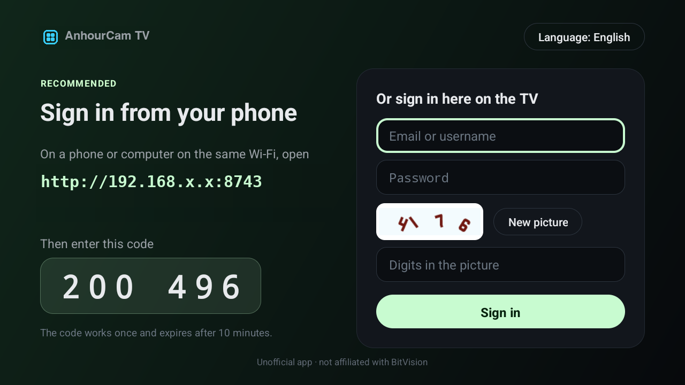
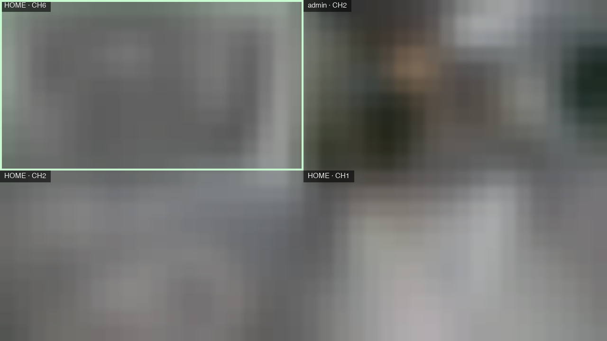
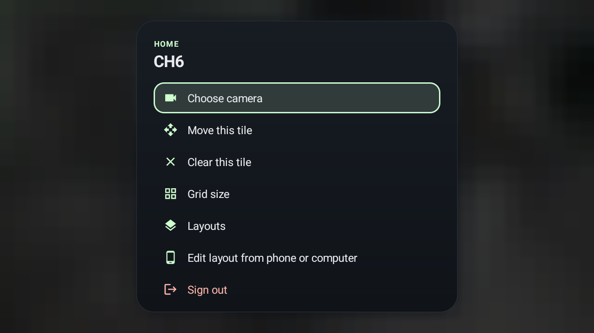
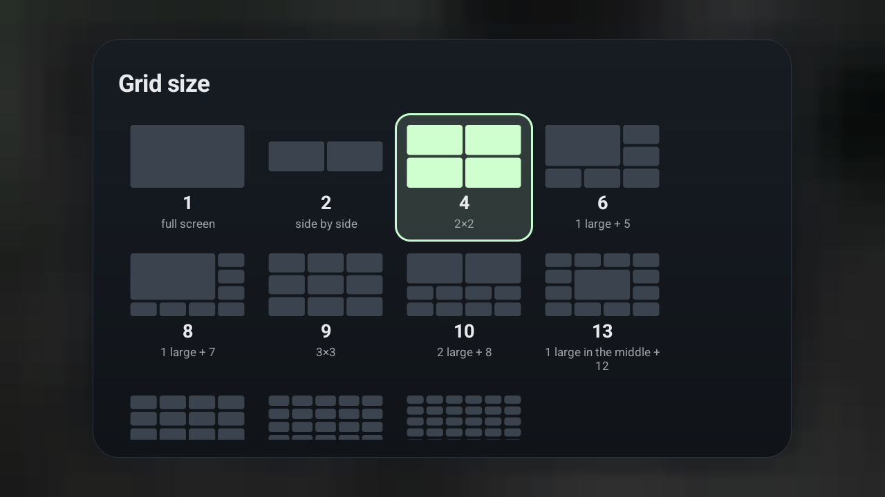
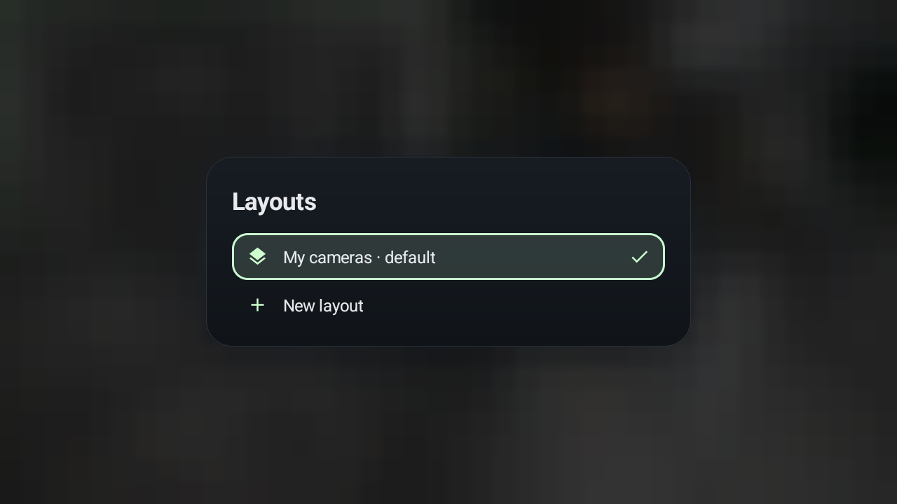
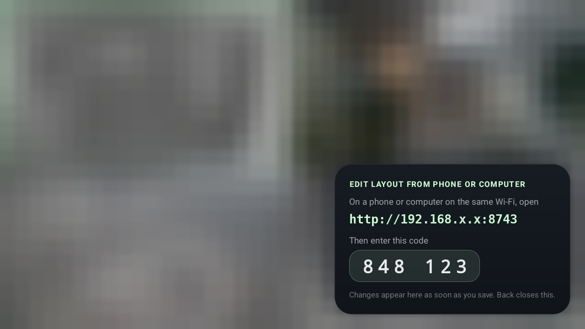
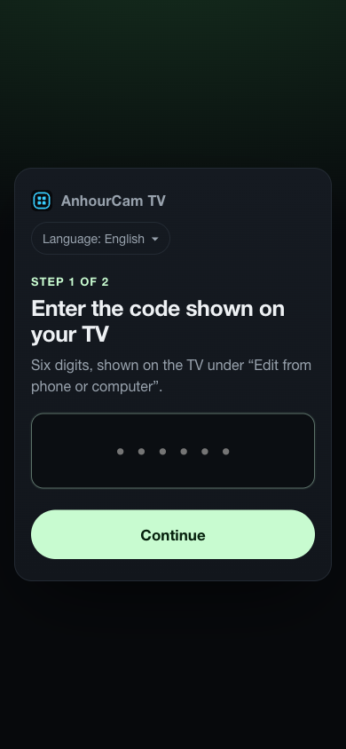
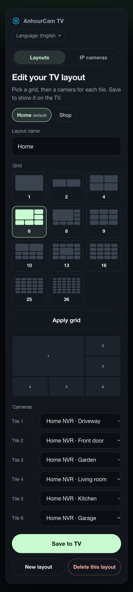
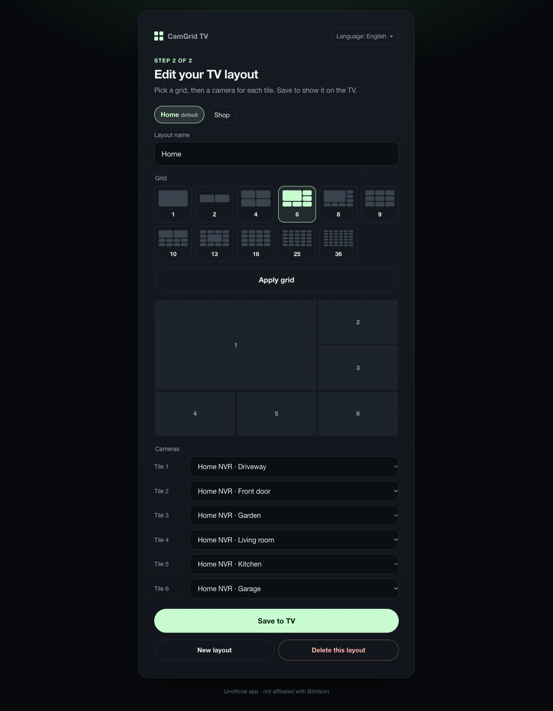

<p align="center">
  <picture>
    <source media="(prefers-color-scheme: dark)" srcset="docs/brand/anhourcam-logo-dark.svg">
    
  </picture>
</p>

<h1 align="center">AnhourCam TV</h1>

<p align="center">
  <b>Watch your BitVision cameras on Google TV, Android TV and Fire TV.</b><br>
  Live NVR camera grids (4, 9, 16 and more) on the big screen. Native, fast and open source.
</p>

<p align="center">
  <a href="https://github.com/anhourtec/AnhourCam-TV/stargazers"></a>
  <a href="https://github.com/anhourtec/AnhourCam-TV/releases"></a>
  <a href="LICENSE"></a>
  <a href="https://github.com/anhourtec/AnhourCam-TV/graphs/contributors">
    
  </a>
  
  
</p>

<p align="center">
  Built and maintained by <a href="https://github.com/anhourtec"><b>anhourtec</b></a> ·
  <a href="https://github.com/anhourtec/AnhourCam-TV">github.com/anhourtec/AnhourCam-TV</a>
</p>

> **Unofficial.** Not affiliated with, endorsed by or supported by BitVision. BitVision and all
> related software, services and trademarks belong to their owners. See [NOTICE.md](NOTICE.md).

## Start here

| You want to | Go to |
|---|---|
| **Know if it works yet** | [Status](#status): early development, not ready to install yet. |
| **Watch BitVision cameras on a TV** | [What you get](#what-you-get) and [Supported devices](#supported-devices). |
| **Install it (when released)** | [Install](#install): sideload over Wi-Fi, no Play Store needed. |
| **Use BitVision on a phone instead** | The official apps: [Android (Google Play)](https://play.google.com/store/apps/details?id=com.gzch.lsplat.lsbtvapp&hl=en) · [iPhone/iPad (App Store)](https://apps.apple.com/in/app/bitvision/id1419463554) · [Web portal](https://bitvision.app/) |
| **Help build it** | [Contributing](CONTRIBUTING.md) and the [roadmap](docs/roadmap.md). |

[Why this exists](#why-this-exists) · [What you get](#what-you-get) · [Screenshots](#screenshots) · [Status](#status) ·
[Supported devices](#supported-devices) · [Install](#install) · [How it works](#how-it-works) ·
[Build and run](#build-and-run-on-your-tv-developers) · [Questions people ask](#questions-people-ask) · [Contributing](#contributing) · [Credits](#credits)

## Why this exists

BitVision has apps for [Android phones](https://play.google.com/store/apps/details?id=com.gzch.lsplat.lsbtvapp&hl=en),
[iPhone](https://apps.apple.com/in/app/bitvision/id1419463554) and the [web](https://bitvision.app/),
but **no app for TVs**. If you have BitVision NVRs or DVRs for home or shop CCTV, there has been
no good way to put your cameras on the living-room or shop-counter TV.

AnhourCam TV fills that gap: sign in with **your own** BitVision account and see every camera from
every NVR on the account, in the grid layouts you know from an NVR monitor.

## What you get

| | |
|---|---|
| **NVR-style grids** | 1, 2, 4, 6, 8, 9, 10, 13, 16, 25 and 36 tiles. Bigger grids fill themselves with your next cameras. |
| **Any camera, any tile** | Mix cameras from several NVRs in one grid. On the TV: hold OK on a tile to choose a camera, move it or change the grid size. |
| **Several layouts** | "Home", "Shop", "Night"… switch with ◀ ▶ at the edge of the grid; pick the one that opens first. |
| **Edit from your phone** | Open the address shown on the TV, enter the code, pick the grid and a camera for every tile, save: the TV updates at once. |
| **Fullscreen in HD** | Press OK on a tile for the high-quality stream; Back returns to the grid. |
| **Easy sign-in** | Open the address shown on the TV on any phone or laptop on the same Wi-Fi, enter the 6-digit code, sign in there. No typing with the remote. |
| **Your language** | English, 中文（简体）, 日本語, Português, Русский on the TV and the phone page. |
| **Remembers everything** | Your layouts, which camera sits in which tile, grid sizes and the last screen you watched are kept on the TV. |
| **Tour mode** | Cycle through pages or layouts automatically. |
| **Remote-first** | Every action works with a basic D-pad remote. Dark, minimal, video first. |
| **Fast** | Native Kotlin with hardware H.265/H.264 decoding straight to the screen. No WebView, no browser inside. Tiles beyond what your TV can play live show refreshing still images. |
| **Private** | Talks only to BitVision's cloud, like the official apps. Your password is used once to sign in and is never stored. |

Screenshots will be added once the first build is ready.

## Screenshots

|                     |               |
| :-----------------------------------------------------------: | :-------------------------------------------------------: |
|          _Sign in from your phone, or on the TV_              |         _A 2×2 grid of cameras from two NVRs_             |
|                      |            |
|          _Hold OK on a tile for its menu_                     |         _Every grid shape as a preview_                   |
|                     |     |
|          _Several saved layouts_                              |         _Edit the layout from your phone_                 |

|  |  |  |
| :---: | :---: | :---: |
| _Phone: enter the TV's code_ | _Phone: grid, cameras, layouts_ | _Computer: the same editor_ |

TV screenshots come from a real Google TV; **camera images are blurred for privacy** and the TV's
address is hidden. Phone and computer screenshots use made-up camera names.

## Status

**Preview.** It works on a real Google TV today and you can [install it](#install) from a computer;
a downloadable release comes with Phase 5. Progress: [docs/progress.md](docs/progress.md) ·
[docs/roadmap.md](docs/roadmap.md).

| Phase | What | State |
|---|---|---|
| 0 | Learn how the BitVision web portal streams video | ✅ done |
| 1 | Kotlin client library | ✅ done |
| 2 | Native video playback (hardware decoding, several tiles at once) | ✅ done |
| 3 | TV app + sign-in (on the TV or from your phone) | ✅ done |
| 4 | Grids, layout editor (TV + phone), several layouts, still images | ✅ mostly done (tour mode next) |
| 5 | Performance polish + first release APK | planned |
| 6 | **Any IP camera** (RTSP / ONVIF): scan your network, add cameras from your phone, no BitVision account needed | in progress ([plan](docs/ipcam.md)) |

Watch or star the repo to hear about the first release.

## Supported devices

| Platform | Support |
|---|---|
| **Google TV** (Chromecast with Google TV, Google TV Streamer, Sony, TCL, Hisense Google TVs…) | Target |
| **Android TV** 7.1+ (NVIDIA Shield, Xiaomi Mi Box, Philips, Sharp…) | Target |
| **Amazon Fire TV** (Fire TV Stick, Stick 4K, Cube, Fire TV smart TVs) | Target (sideload) |
| Samsung Tizen, LG webOS, Roku, Apple TV | Not supported (not Android) |

How many cameras play live at once depends on your device's video decoder. Tiles beyond that
show a still image until you select them.

## Install

AnhourCam TV isn't on Google Play or the Amazon Appstore; you install it yourself ("sideload").
It takes about ten minutes the first time.

> **Status:** there is no downloadable release yet. Until the first release is published on the
> [Releases page](https://github.com/anhourtec/AnhourCam-TV/releases), install it from a computer
> (option A). Option B (no computer) works as soon as a release exists.

### What you need

- A Google TV, Android TV (7.1 or newer) or Amazon Fire TV on the same Wi-Fi as your phone.
- Your BitVision account (the one you use in the BitVision phone app).
- For option A: a computer (Mac, Windows or Linux) on the same Wi-Fi.

### Step 1: Turn on developer options on the TV

| Google TV / Android TV | Fire TV |
| --- | --- |
| Settings → **System** → **About** → press OK on **Android TV OS build** 7 times, until "You are now a developer" appears. | Settings → **My Fire TV** → **About** → press OK on your device name 7 times, until "You are now a developer" appears. |

### Option A: Install from a computer

1. **Install Android's adb tool** on the computer:
   [Android SDK Platform-Tools](https://developer.android.com/tools/releases/platform-tools)
   (macOS with Homebrew: `brew install android-platform-tools`).
2. **Turn on debugging on the TV.**
   - *Google TV / Android TV 11+:* Settings → System → **Developer options** → **Wireless debugging**
     → **Pair device with pairing code**. Keep this screen open; it shows an address, a port and a
     6-digit code.
   - *Fire TV and older Android TV:* Settings → My Fire TV (or System) → **Developer options** →
     turn on **ADB debugging**. Find the TV's IP address under Settings → Network.
3. **Connect the computer to the TV** (use the numbers shown on your TV):
   ```bash
   # Google TV / Android TV 11+ (wireless debugging)
   adb pair <TV_IP>:<PAIRING_PORT> <PAIRING_CODE>
   adb connect <TV_IP>:<CONNECT_PORT>      # often happens automatically after pairing

   # Fire TV / older Android TV
   adb connect <TV_IP>:5555                # then press "Allow" on the TV
   ```
   `adb devices` should now list your TV.
4. **Get the app.** Download `camgrid-tv.apk` from the
   [Releases page](https://github.com/anhourtec/AnhourCam-TV/releases) once available, or build it
   yourself (needs JDK 17+ and the Android SDK):
   ```bash
   git clone https://github.com/anhourtec/AnhourCam-TV && cd AnhourCam-TV
   ./gradlew :app:assembleDebug            # → app/build/outputs/apk/debug/app-debug.apk
   ```
5. **Install it:**
   ```bash
   adb install -r camgrid-tv.apk           # or app/build/outputs/apk/debug/app-debug.apk
   ```
6. **Turn debugging off again** when you're done (Wireless debugging / ADB debugging). The app
   doesn't need it.

### Option B: Install without a computer (once a release exists)

1. On the TV, install **Downloader** by AFTVnews from the Google Play Store or the Amazon Appstore.
2. Allow it to install apps:
   - *Google TV:* Settings → Apps → **Security & restrictions** → **Unknown sources** → turn on
     **Downloader**.
   - *Fire TV:* Settings → My Fire TV → **Developer options** → **Install unknown apps** → turn on
     **Downloader**.
3. In Downloader, enter the APK link from the
   [Releases page](https://github.com/anhourtec/AnhourCam-TV/releases), download it and press
   **Install**.

### Step 2: First start

1. Open **AnhourCam TV** from your apps row.
2. The TV shows an address like `http://192.168.x.x:8743` and a 6-digit code. On your phone
   (same Wi-Fi), open that address, enter the code, then your BitVision email, password and the
   digits in the picture. (You can also sign in right on the TV.)
3. Your first cameras open in a 2×2 grid.

### Using it

| Remote | What it does |
| --- | --- |
| Arrows | Move between tiles; at the edge of the grid ◀ ▶ switch layouts |
| OK | Open the camera fullscreen in HD (Back returns); on a stalled tile, try again |
| Hold OK (or Menu) | Tile menu: choose camera, move, clear, grid size, layouts, edit from phone, sign out |
| Back | Close a card or dialog, leave fullscreen, then exit |

To set everything up from your phone: hold OK → **Edit layout from phone or computer**, open the
address on the card, enter its code, choose grids and cameras, and **Save to TV**.

### Updating and removing

- **Update:** install the new APK the same way (`adb install -r …`, or download it again in
  Downloader). Your sign-in and layouts are kept.
- **Remove:** Settings → Apps → AnhourCam TV → **Uninstall**.

## Build and run on your TV (developers)

Every step we use, in order. You need a computer on the same Wi-Fi as the TV, JDK 17+ and the
Android SDK platform-tools (`adb`).

1. **Turn on developer mode on the TV.** Settings → System → About → press OK on
   *Android TV OS build* 7 times.
2. **Turn on wireless debugging.** Settings → System → Developer options → *Wireless debugging* →
   *Pair device with pairing code*. Keep that screen open.
3. **Pair and connect** (use the IP, ports and code shown on the TV):
   ```bash
   adb pair <TV_IP>:<PAIRING_PORT> <PAIRING_CODE>
   adb connect <TV_IP>:<CONNECT_PORT>   # usually automatic after pairing; check with: adb devices
   ```
4. **Build and install:**
   ```bash
   git clone https://github.com/anhourtec/AnhourCam-TV && cd AnhourCam-TV
   ./gradlew :app:assembleDebug
   adb install -r app/build/outputs/apk/debug/app-debug.apk
   ```
5. **Open AnhourCam TV** from the TV's apps row.
6. **Sign in from your phone:** the TV shows an address like `http://192.168.x.x:8743` and a
   6-digit code. Open the address on your phone (same Wi-Fi), enter the code, then your BitVision
   email, password and the digits in the picture. The TV signs in and opens your cameras.
   (Or sign in directly on the TV with the remote.)
7. **Use it:** arrows move between tiles, OK opens a camera fullscreen (Back returns), hold OK on
   a tile for its menu (choose camera, move, clear, grid size, layouts, edit from phone, sign out).
   ◀ ▶ at the edge of the grid switches between your saved layouts.
8. **Edit from your phone:** tile menu → *Edit layout from phone or computer*; open the address on
   the card, enter its code, choose grid and cameras, *Save to TV*. Back closes the card.
9. When you're done, turn *Wireless debugging* off again (the app doesn't need it).

Quality checks before every change: `./gradlew ktlintCheck detekt test :app:lintDebug`.

## How it works

1. You sign in with your BitVision account, on the TV or from your phone through a one-time
   pairing page served by the TV on your local network.
2. AnhourCam TV lists your NVRs and their channels, as the web portal does.
3. Each tile opens the camera's live stream from BitVision's cloud relay and hands the H.265/H.264
   video to the TV's hardware decoder.

Technical details: [architecture](docs/architecture.md) · [streaming](docs/streaming.md) ·
[security](docs/security.md) · [full spec](docs/SPEC.md).

## Questions people ask

**Is there a BitVision app for Android TV, Google TV or Fire TV?**
Not an official one, as far as we know. AnhourCam TV is an unofficial, open-source app that does
this job.

**Can I watch BitVision cameras on my TV?**
That's what this project is for: live view of BitVision NVR/DVR cameras on Google TV, Android TV
and Fire TV (Firestick), with multi-camera grids.

**Can I install the BitVision phone app on my TV instead?**
You can try to sideload the phone APK, but phone apps are made for touch screens and usually work
poorly with a TV remote. AnhourCam TV is built for the remote from the start.

**Does it work with my NVR or DVR brand?**
If your recorder shows up in your BitVision account (the BitVision app or
[bitvision.app](https://bitvision.app/)), AnhourCam TV aims to support it.

**Does it need my NVR's IP address or port forwarding?**
No. Like the official apps, it uses your BitVision cloud account.

**Do I need a browser or a computer to sign in?**
No. BitVision asks for a short picture code (CAPTCHA) when you sign in. AnhourCam TV shows that
picture on the TV, or on your phone if you sign in from your phone, and you type the digits. Nothing
else to install.

**Will it log me out after a while, like the website?**
No. Your cameras keep playing even if the website session expires, and the app keeps the session
alive in the background. You only sign in again if the TV was off for a long time, and even then
live view keeps working.

**Why do some tiles show "Still image"?**
Each live camera needs a video decoder, and TVs have only a few: a budget Google TV may play 4 at
once (2 in hardware, 2 in software). Tiles beyond that show a still picture that refreshes every
few seconds, and go live as soon as a decoder frees up.
Streamers like the Chromecast with Google TV 4K, Google TV Streamer, NVIDIA Shield or Fire TV 4K
Max have more decoders and play more tiles live.

**Is it safe? Where does my password go?**
Only to BitVision's sign-in, once. It is never saved; only the session is kept, encrypted on the
TV. Phone pairing uses a short-lived, single-use code on your local network. See
[docs/security.md](docs/security.md).

**Is this official or affiliated with BitVision?**
No. See [NOTICE.md](NOTICE.md). Use it only with your own account and devices.

## Support

Questions, bugs, a camera that won't connect, or an idea: please
[open an issue on GitHub](https://github.com/anhourtec/AnhourCam-TV/issues). Include your TV model
and what you tried, but never passwords, account details, IP addresses or camera images.

## Contributing

Issues and pull requests are welcome; see [CONTRIBUTING.md](CONTRIBUTING.md). Security issues:
[SECURITY.md](SECURITY.md). Please never post account details, device serials, IP addresses or
camera images in issues.

## Credits

Created and maintained by **[anhourtec](https://github.com/anhourtec)**. If AnhourCam TV helps
you, star the repo and share it with anyone stuck watching their CCTV on a phone.

## License

[Apache License 2.0](LICENSE) for this project's own code. BitVision, its apps, services and
trademarks belong to their respective owners. See [NOTICE.md](NOTICE.md).

<!-- Keywords: BitVision TV app, BitVision Android TV, BitVision Google TV, BitVision Fire TV, BitVision Firestick, BitVision NVR on TV, BitVision DVR TV, watch CCTV on Google TV, NVR multi-camera grid Android TV, bitvision.app TV -->
